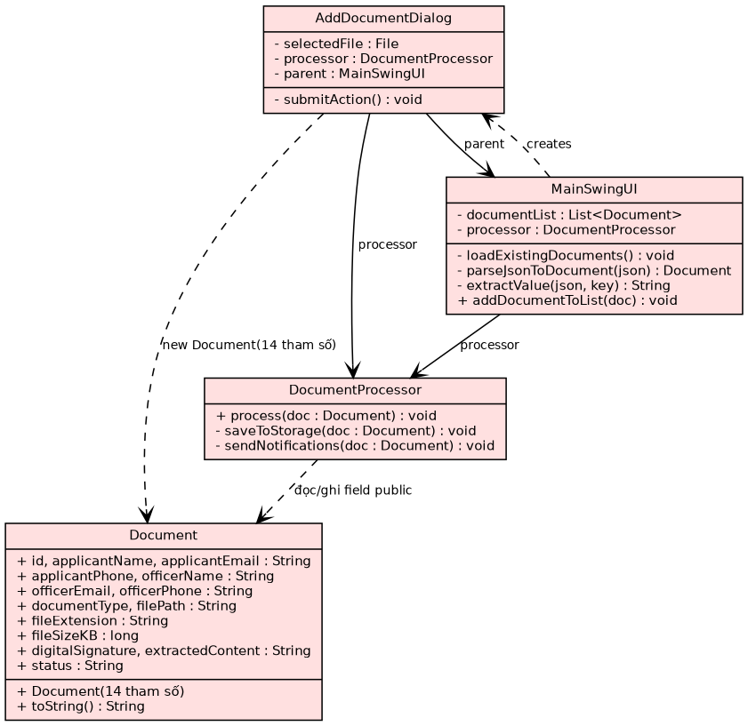
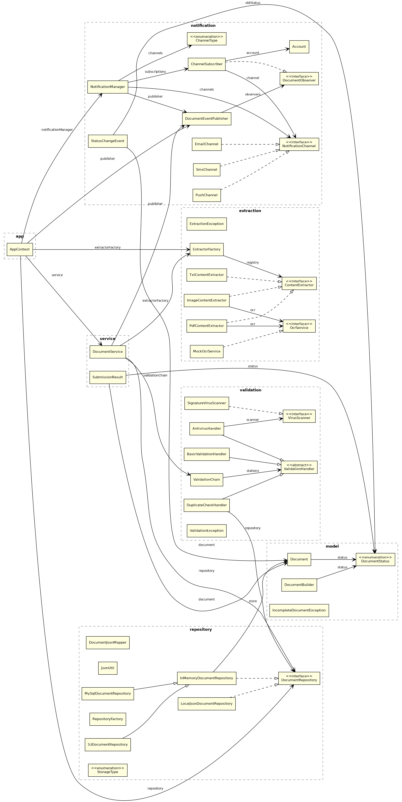
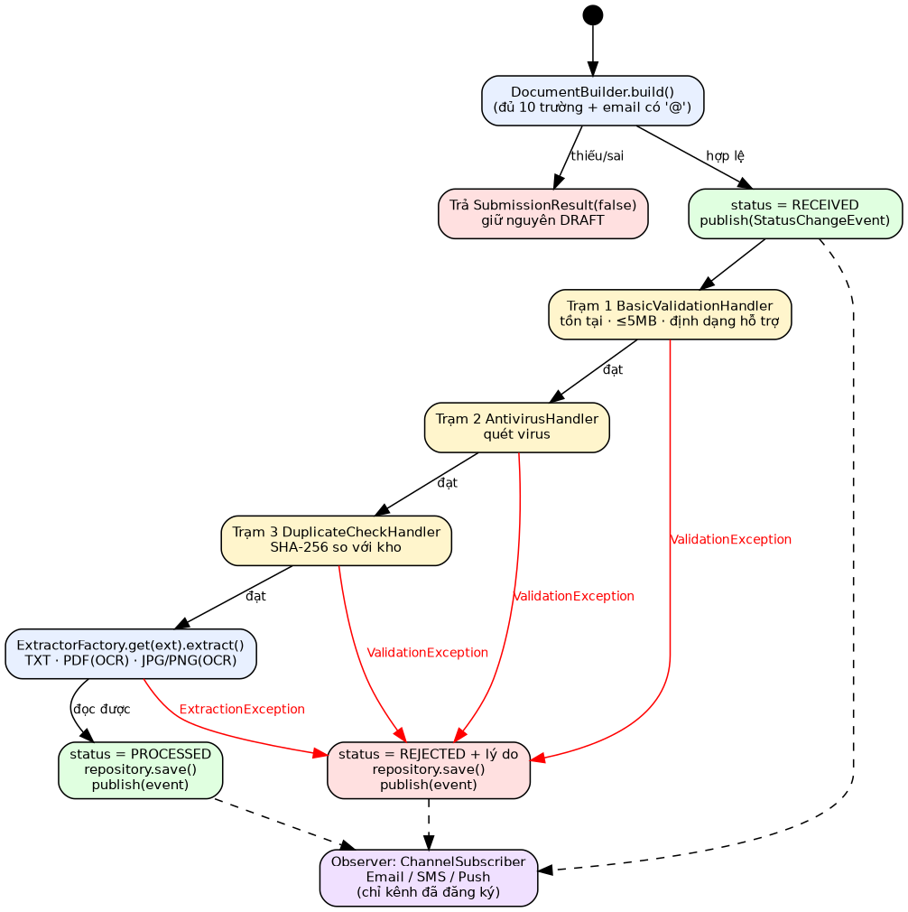
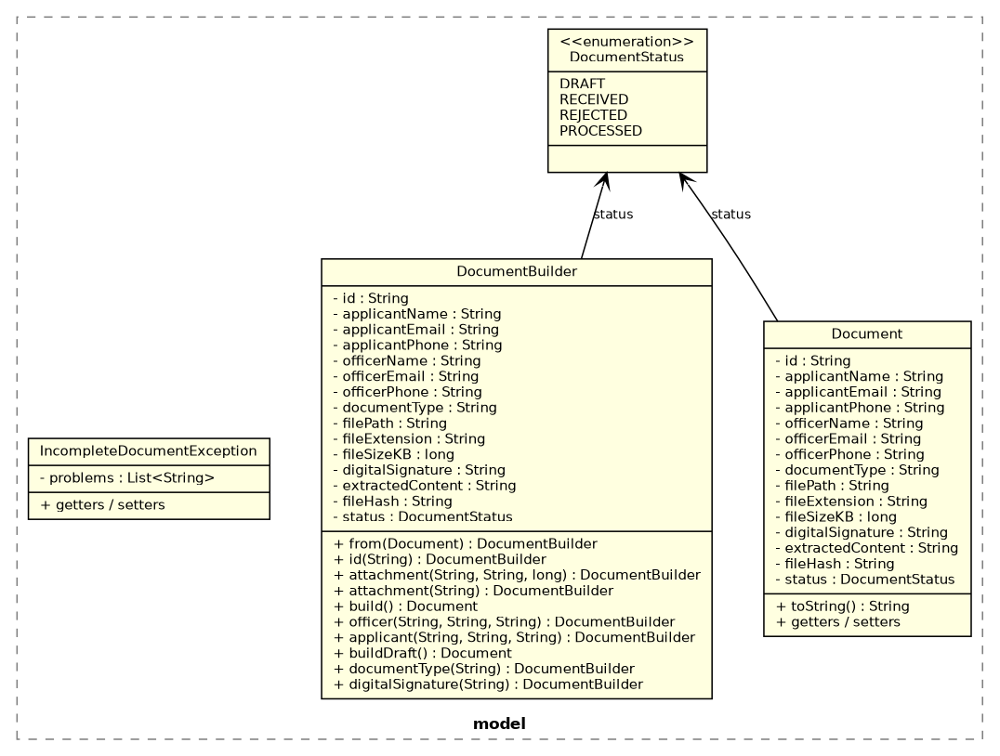
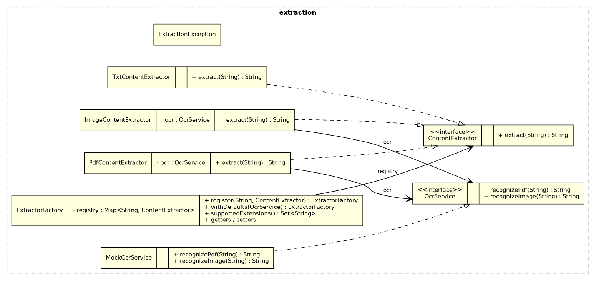
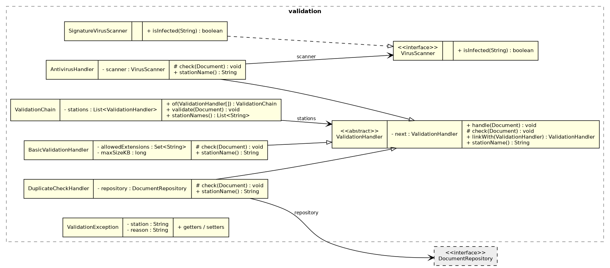
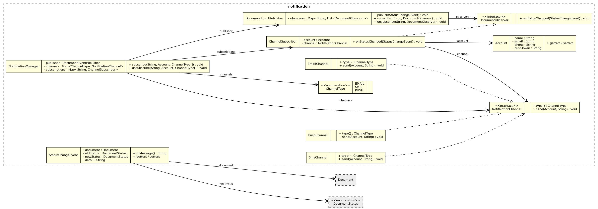
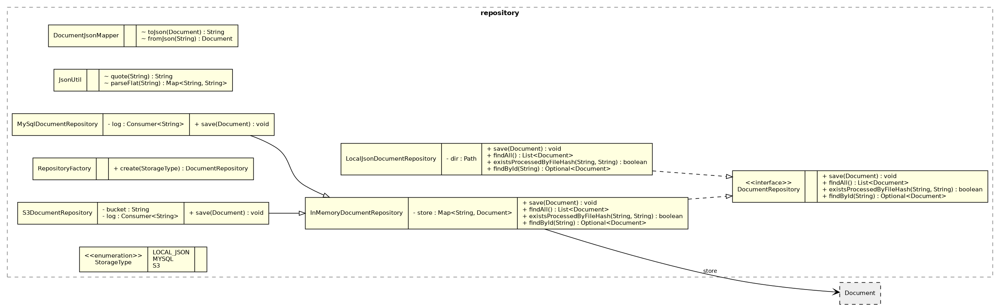

# Báo cáo giữa kỳ: Nâng cấp Hệ thống Tiếp nhận và Xử lý Hồ sơ Điện tử v1.0 → v2.0

> Môn Design Pattern · Nhóm: *<điền họ tên + MSSV>* · Video: *<dán link>*
> Cách chạy xem `readme.txt`. Log và số liệu trong báo cáo lấy từ lần chạy thật của `TestRunner` và `DemoMain` (JDK 21).

## 1. Tổng quan

Không viết lại từ đầu: giữ các nghiệp vụ gốc (tiếp nhận, kiểm duyệt, trích xuất, lưu trữ, thông báo) nhưng tách mỗi trách nhiệm ra khỏi `DocumentProcessor` và áp **5 pattern**, mỗi pattern giải đúng một yêu cầu của đề.

| Yêu cầu | Rủi ro của v1.0 | Pattern chọn | Lớp chính | Số test |
|---|---|---|---|---|
| 1. Lưu nháp, nộp từng bước | Constructor 14 tham số, phải có đủ dữ liệu ngay từ đầu | **Builder** | `DocumentBuilder` | 4 |
| 2. Đọc PDF / ảnh, dễ thêm định dạng | `if (!ext.equals("txt"))` cứng trong luồng chính (vi phạm OCP) | **Strategy + Factory (registry)** | `ContentExtractor`, `ExtractorFactory` | 4 |
| 3. Kiểm duyệt 3 trạm, đổi thứ tự được | Chuỗi `if…return` cố định, lặp 3 lần đoạn từ chối | **Chain of Responsibility** | `ValidationHandler`, `ValidationChain` | 5 |
| 4. Chọn kênh nhận thông báo | `sendNotifications()` gửi cố định 4 tin, luồng chính gọi trực tiếp | **Observer** | `DocumentEventPublisher`, `ChannelSubscriber` | 4 |
| 5. Lưu JSON / MySQL / S3 | Ghép chuỗi JSON và ghi tệp ngay trong `DocumentProcessor` | **Repository** (+ Factory Method chọn kho) | `DocumentRepository`, `RepositoryFactory` | 3 |

## 2. Phân tích hiện trạng v1.0

### 2.1 Cấu trúc trước khi refactor



### 2.2 Các thiết kế lỗi (code smell) và hệ lụy

| # | Vị trí trong code v1.0 | Lỗi thiết kế | Hệ lụy |
|---|---|---|---|
| 1 | `Document`: 14 field `public`, constructor 14 tham số | Telescoping constructor, không đóng gói | Không thể lưu nháp; dễ truyền nhầm thứ tự các tham số cùng kiểu `String`; ai cũng sửa được trạng thái |
| 2 | `DocumentProcessor.process()` | God method: tiếp nhận + kiểm duyệt + trích xuất + lưu + thông báo | Sửa một nghiệp vụ phải mở lại hàm này; khó test riêng từng bước (vi phạm SRP) |
| 3 | `fileExtension.equalsIgnoreCase("txt")` | Rẽ nhánh cứng theo định dạng | Thêm PDF/ảnh phải sửa luồng trung tâm (vi phạm OCP) |
| 4 | 3 khối `status = "TU_CHOI"; sendNotifications(doc); return;` | Trình tự kiểm duyệt cố định + lặp mã | Đổi thứ tự / thêm trạm là sửa hàm chính; dễ quên một nhánh |
| 5 | `sendNotifications()` luôn gửi Email + SMS cho cả 2 bên | Luồng chính gọi trực tiếp module thông báo (tight coupling) | Không chọn được kênh; thêm Push phải sửa `process()` |
| 6 | `saveToStorage()` ghép chuỗi JSON, dùng `FileWriter` | Logic dữ liệu lẫn logic nghiệp vụ; JSON không escape | Tên có dấu `"` làm hỏng tệp JSON; `extractedContent` không bao giờ được lưu; không đổi được sang DB/S3 |
| 7 | `MainSwingUI.parseJsonToDocument/extractValue` | UI tự đọc thư mục và tự phân tích JSON | Giao diện biết định dạng lưu trữ; trùng tri thức với `saveToStorage` |
| 8 | Trạng thái là chuỗi `"DANG_XET_DUYET"`, UI so sánh chuỗi để biết thành công | Magic string; lỗi chỉ báo qua `println` | Gõ sai là hỏng âm thầm; UI không biết **lý do** bị từ chối |

> **Lệch giữa đề và mã v1.0:** đề nêu 13 trường, kiểm tra email có `@`, kiểm tra tệp tồn tại và quy tắc "ưu tiên ≥ 2 thì báo trưởng phòng"; mã v1.0 thực tế có 11 trường bắt buộc và **không** có các kiểm tra/quy tắc đó. v2.0 bám theo mã nguồn, đồng thời bổ sung kiểm tra email (ở `DocumentBuilder.build()`) và tệp tồn tại (trạm 1). Quy tắc ưu tiên được thay bằng cơ chế đăng ký kênh của yêu cầu 4 (cán bộ tự chọn kênh) nên không giữ lại.

## 3. Kiến trúc v2.0



*Hình chỉ vẽ tên lớp và quan hệ; thuộc tính/phương thức ở các hình theo từng yêu cầu bên dưới. Mọi sơ đồ v2.0 được **sinh tự động bằng reflection từ các lớp đã biên dịch**, nên tên lớp/phương thức khớp với mã nộp (getter/setter gộp thành một dòng). Quan hệ "tạo ra" (ví dụ `DocumentBuilder` → `Document`) không vẽ.*

Luồng xử lý khi nộp hồ sơ (`DocumentService.submit`):



```java
    public SubmissionResult submit(DocumentBuilder builder) {
        Document doc;
        try {
            doc = builder.build();
        } catch (IncompleteDocumentException e) {
            System.out.println("[LỖI TIẾP NHẬN] " + e.getMessage());
            return new SubmissionResult(false, DocumentStatus.DRAFT, e.getMessage(), null);
        }
        System.out.println("\n=== XỬ LÝ HỒ SƠ " + doc.getId() + " ===");
        changeStatus(doc, DocumentStatus.RECEIVED, null);

        try {
            validationChain.validate(doc);
        } catch (ValidationException e) {
            return reject(doc, e.getMessage());
        }

        try {
            doc.setExtractedContent(extractorFactory.get(doc.getFileExtension()).extract(doc.getFilePath()));
        } catch (ExtractionException e) {
            return reject(doc, e.getMessage());
        }

        doc.setStatus(DocumentStatus.PROCESSED);
        repository.save(doc);
        publisher.publish(new StatusChangeEvent(doc, DocumentStatus.RECEIVED, DocumentStatus.PROCESSED, null));
        System.out.println("[HOÀN TẤT] Hồ sơ " + doc.getId() + " đã xử lý và lưu trữ.");
        return new SubmissionResult(true, DocumentStatus.PROCESSED, "Hồ sơ đã được xử lý", doc);
    }
```

Quy tắc phụ thuộc: `DocumentService` chỉ biết **interface** (`DocumentRepository`, `ExtractorFactory`, `DocumentEventPublisher`, `ValidationChain`). Nơi duy nhất `new` các lớp cụ thể là `AppContext` (composition root):

```java
        ValidationChain chain = ValidationChain.of(
                new BasicValidationHandler(extractorFactory.supportedExtensions(), MAX_SIZE_KB),
                new AntivirusHandler(new SignatureVirusScanner()),
                new DuplicateCheckHandler(repository));
```

## 4. Yêu cầu 1: Lưu nháp và nộp từng bước → **Builder**



**Lập luận.** Vấn đề là *khởi tạo đối tượng từ dữ liệu đến dần*. `DocumentBuilder` gom dữ liệu từng bước (`applicant()`, `officer()`, `attachment()`…) và có **hai đầu ra**: `buildDraft()` không đòi trường nào (lưu nháp), `build()` kiểm tra đủ trường rồi mới tạo hồ sơ để nộp. `from(Document)` nạp lại bản nháp để làm tiếp; `attachment(path)` tự suy ra đuôi file và dung lượng nên UI không phải tính.

```java
    public Document build() throws IncompleteDocumentException {
        List<String> problems = new ArrayList<>();
        require(applicantName, "Tên người nộp", problems);
        require(applicantEmail, "Email người nộp", problems);
        require(applicantPhone, "SĐT người nộp", problems);
        require(officerName, "Tên cán bộ", problems);
        require(officerEmail, "Email cán bộ", problems);
        require(officerPhone, "SĐT cán bộ", problems);
        require(documentType, "Loại hồ sơ", problems);
        require(filePath, "Tệp đính kèm", problems);
        require(fileExtension, "Đuôi tệp", problems);
        require(digitalSignature, "Chữ ký số", problems);
        if (isFilled(applicantEmail) && !applicantEmail.contains("@")) {
            problems.add("Email người nộp sai định dạng (thiếu '@')");
        }
        if (!problems.isEmpty()) throw new IncompleteDocumentException(problems);
        return create();
    }
```

| Phương án | Vì sao không chọn |
|---|---|
| Giữ constructor 14 tham số | Chính là vấn đề cần giải quyết |
| Constructor chồng (telescoping) | Quá nhiều tổ hợp tham số, khó đọc |
| Setter trên `Document` | Đối tượng tồn tại ở trạng thái dở dang, không có thời điểm nào kiểm tra "đã đủ" |
| Factory Method | Vẫn tạo đối tượng trong một lần gọi, không lắp ráp từng phần |

`Document` nay bất biến với dữ liệu biểu mẫu (`final`); chỉ `status`, `extractedContent`, `fileHash` đổi theo quy trình.

## 5. Yêu cầu 2: Nhiều định dạng tài liệu → **Strategy + Factory (registry)**



**Lập luận.** Mỗi định dạng là một *thuật toán đọc* khác nhau → mỗi cái một `ContentExtractor` (Strategy). `ExtractorFactory` giữ bảng `đuôi file → strategy`; luồng chính chỉ gọi `get(ext).extract(path)`, **không có if/switch**. OCR bên thứ ba nằm sau interface `OcrService` (ở đây là `MockOcrService`); muốn dùng dịch vụ thật chỉ cần viết một lớp bọc nó (Adapter) mà không đổi extractor.

```java
    public ExtractorFactory register(String extension, ContentExtractor extractor) {
        registry.put(extension.toLowerCase(Locale.ROOT), extractor);
        return this;
    }

    public ContentExtractor get(String extension) throws ExtractionException {
        ContentExtractor e = registry.get(extension == null ? "" : extension.toLowerCase(Locale.ROOT));
        if (e == null) throw new ExtractionException("Chưa hỗ trợ trích xuất định dạng: ." + extension);
        return e;
    }
```

Danh sách đuôi hợp lệ của trạm kiểm tra 1 lấy từ `supportedExtensions()`, nên thêm định dạng chỉ cần `register(...)` một lần (test `Thêm định dạng mới không sửa DocumentService` chứng minh điều này).

| Phương án | Vì sao không chọn |
|---|---|
| `if/else`, `switch` theo đuôi | Vi phạm OCP: mỗi định dạng mới phải sửa luồng trung tâm |
| Template Method (kế thừa) | Các định dạng khác nhau toàn bộ thuật toán, không có khung chung để tái dùng; kế thừa cứng hơn ghép đối tượng |
| Decorator | Dùng để chồng thêm hành vi lên cùng một việc, không phải chọn *một* cách đọc |

## 6. Yêu cầu 3: Quy trình kiểm duyệt → **Chain of Responsibility**



**Lập luận.** Ba trạm độc lập, chạy tuần tự, dừng ngay khi một trạm không đạt. `ValidationHandler.handle()` là Template Method `final`: chạy `check()` của trạm mình, đạt thì chuyển trạm kế; không đạt thì `check()` ném `ValidationException` mang **tên trạm + lý do**, chuỗi tự dừng (không cần mỗi trạm tự `return`).

```java
public abstract class ValidationHandler {
    private ValidationHandler next;

    /** Nối trạm kế tiếp, trả về trạm đó để nối liên tiếp. */
    public ValidationHandler linkWith(ValidationHandler next) {
        this.next = next;
        return next;
    }

    public final void handle(Document doc) throws ValidationException {
        check(doc);
        if (next != null) next.handle(doc);
    }

    protected abstract void check(Document doc) throws ValidationException;

    public abstract String stationName();
}
```

Quản trị viên cấu hình thứ tự bằng cách liệt kê trạm; `ValidationChain` tự nối chúng:

```java
    public static ValidationChain of(ValidationHandler... handlers) {
        List<ValidationHandler> list = new ArrayList<>(Arrays.asList(handlers));
        for (int i = 0; i + 1 < list.size(); i++) list.get(i).linkWith(list.get(i + 1));
        if (!list.isEmpty()) list.get(list.size() - 1).linkWith(null);
        return new ValidationChain(list);
    }

    /** Chạy lần lượt các trạm; dừng và ném ValidationException ngay ở trạm đầu tiên thất bại. */
    public void validate(Document doc) throws ValidationException {
        if (!stations.isEmpty()) stations.get(0).handle(doc);
    }
```

`DuplicateCheckHandler` chỉ phụ thuộc interface `DocumentRepository` (tra mã băm SHA-256), `AntivirusHandler` chỉ phụ thuộc `VirusScanner`, nên các trạm không biết nhau.

| Phương án | Vì sao không chọn / đánh đổi |
|---|---|
| `if…return` tuần tự như v1 | Chính là lỗi cần sửa |
| Vòng lặp `List<Validator>` | Cũng chạy được và đơn giản hơn. Chọn CoR vì đề yêu cầu "đường ống liên kết" và mỗi trạm tự quyết định chuyển tiếp/dừng. **Đánh đổi:** một instance trạm chỉ thuộc một chuỗi (vì giữ liên kết `next`) |
| Decorator | Mục đích là bọc thêm hành vi, không phải "đạt thì đi tiếp, hỏng thì dừng" |

**Ngắt luồng và ngoại lệ:** `DocumentService.submit` bắt `ValidationException` → trạng thái `REJECTED`, lưu kho, phát sự kiện kèm lý do; UI nhận lý do qua `SubmissionResult.getMessage()`. Trích log demo:

```text
Chuỗi mặc định: Kiểm tra cơ bản -> Quét Antivirus -> Kiểm tra trùng lặp

>> (a) Quá dung lượng 5MB

=== XỬ LÝ HỒ SƠ 1cae9378 ===
[TỪ CHỐI] [Kiểm tra cơ bản] Dung lượng 6000KB vượt quá giới hạn 5120KB

>> (b) Nhiễm virus

=== XỬ LÝ HỒ SƠ 7e2dc562 ===
[TỪ CHỐI] [Quét Antivirus] Phát hiện mã độc trong tệp đính kèm

>> (c) Nộp trùng nội dung với hồ sơ đã xử lý (bao_cao.txt)

=== XỬ LÝ HỒ SƠ 861f9e67 ===
[TỪ CHỐI] [Kiểm tra trùng lặp] Hồ sơ trùng lặp với một hồ sơ đã được xử lý (hash c965a1ba9a9d...)

>> (d) Quản trị viên đổi thứ tự: Trùng lặp -> Antivirus (bỏ trạm cơ bản)
   Chuỗi mới: [Kiểm tra trùng lặp, Quét Antivirus]

=== XỬ LÝ HỒ SƠ 1d6ab181 ===
[TỪ CHỐI] [Quét Antivirus] Phát hiện mã độc trong tệp đính kèm
```

## 7. Yêu cầu 4: Đăng ký nhận thông báo → **Observer**



**Lập luận.** Luồng nghiệp vụ chỉ nói "trạng thái hồ sơ đã đổi", không biết ai nhận qua kênh nào. `DocumentEventPublisher` (Subject) phát `StatusChangeEvent` đến các `DocumentObserver` đã đăng ký theo **mã hồ sơ**. Mỗi đăng ký là một `ChannelSubscriber` = (tài khoản, kênh). `NotificationManager` biến lựa chọn Email / SMS / Push của tài khoản thành các subscriber tương ứng. Kênh (`NotificationChannel`) là một Strategy nhỏ bên trong Observer, nên thêm kênh mới chỉ cần thêm một lớp.

```java
    public void publish(StatusChangeEvent event) {
        List<DocumentObserver> list = observers.get(event.getDocument().getId());
        if (list == null) return;
        for (DocumentObserver o : new ArrayList<>(list)) {
            try {
                o.onStatusChanged(event);
            } catch (RuntimeException e) {
                System.out.println("  [LỖI THÔNG BÁO] " + e.getMessage());
            }
        }
    }

    public void subscribe(String documentId, Account account, ChannelType... types) {
        for (ChannelType type : types) {
            String key = key(documentId, account, type);
            if (subscriptions.containsKey(key)) continue;
            ChannelSubscriber s = new ChannelSubscriber(account, channels.get(type));
            subscriptions.put(key, s);
            publisher.subscribe(documentId, s);
        }
    }
```

Một observer lỗi không làm hỏng các observer khác.

| Phương án | Vì sao không chọn |
|---|---|
| Gọi trực tiếp `sendEmail/sendSms` như v1 | Tight coupling, không chọn được kênh |
| Mediator | Trung tâm phải biết mọi bên, quay lại một lớp ôm đồm |
| Message broker (Kafka/RabbitMQ) | Quá nặng cho một tiến trình; Observer đã đủ ý nghĩa pub/sub |
| Chỉ dùng Strategy cho kênh | Chọn được *một* kênh, không phát đồng thời cho nhiều người nhận |

Log demo (người nộp: Email + SMS, cán bộ: chỉ Push; hồ sơ không ai đăng ký thì không gửi gì):

```text
Người nộp chọn: EMAIL + SMS | Cán bộ chọn: chỉ APP PUSH

=== XỬ LÝ HỒ SƠ e6626abf ===
  [GỬI EMAIL] -> Nguyễn Văn A (a@gmail.com): Hồ sơ e6626abf chuyển sang trạng thái Đã tiếp nhận
  [GỬI SMS]   -> Nguyễn Văn A (0901111111): Hồ sơ e6626abf chuyển sang trạng thái Đã tiếp nhận
  [APP PUSH]  -> Cán bộ trực ban (push-officer): Hồ sơ e6626abf chuyển sang trạng thái Đã tiếp nhận
  [GỬI EMAIL] -> Nguyễn Văn A (a@gmail.com): Hồ sơ e6626abf chuyển sang trạng thái Đã xử lý
  [GỬI SMS]   -> Nguyễn Văn A (0901111111): Hồ sơ e6626abf chuyển sang trạng thái Đã xử lý
  [APP PUSH]  -> Cán bộ trực ban (push-officer): Hồ sơ e6626abf chuyển sang trạng thái Đã xử lý
[HOÀN TẤT] Hồ sơ e6626abf đã xử lý và lưu trữ.

Hồ sơ không ai đăng ký -> không gửi thông báo nào:

=== XỬ LÝ HỒ SƠ ae75506b ===
[HOÀN TẤT] Hồ sơ ae75506b đã xử lý và lưu trữ.
```

## 8. Yêu cầu 5: Mở rộng lưu trữ → **Repository**



**Lập luận.** Nghiệp vụ chỉ cần "lưu / tìm hồ sơ" như thao tác trên một bộ sưu tập. Interface dưới đây là thứ **duy nhất** tầng nghiệp vụ nhìn thấy; mã JSON, SQL, S3 nằm trọn trong từng lớp cài đặt:

```java
public interface DocumentRepository {
    void save(Document doc);

    Optional<Document> findById(String id);

    List<Document> findAll();

    /** Có hồ sơ khác (đã xử lý) mang cùng mã băm tệp không? Dùng để chống nộp trùng. */
    boolean existsProcessedByFileHash(String fileHash, String excludeDocumentId);
}
```

`LocalJsonDocumentRepository` ghi thật `{id}_data.json` (có escape) và sao chép tệp đính kèm như v1; `MySqlDocumentRepository` và `S3DocumentRepository` là bản giả lập log SQL/PUT (đề cho phép). `RepositoryFactory` (Factory Method) chọn kho theo `StorageType`; UI có ô chọn để đổi qua lại.

| Phương án | Vì sao không chọn |
|---|---|
| DAO | Gắn với bảng/CSDL; Repository nói bằng ngôn ngữ nghiệp vụ nên hợp cả S3 lẫn JSON |
| Active Record (`doc.save()`) | Model biết chỗ lưu, rò rỉ mã kết nối vào lớp lõi, đúng điều đề cấm |
| Facade | Che giấu độ phức tạp nhưng không tạo điểm thay thế cho nhiều kho |

Log demo khi cùng một đoạn mã nghiệp vụ chạy trên các kho khác nhau:

```text
>> Nơi lưu trữ: MYSQL (cùng một đoạn mã nghiệp vụ)

=== XỬ LÝ HỒ SƠ e692eca8 ===
  [MySQL] INSERT INTO documents(id, applicant, type, status, file_hash) VALUES('e692eca8','Nguyễn Văn A','BAO_CAO','PROCESSED','869bbe9b0aa9f6b368de40 ...
[HOÀN TẤT] Hồ sơ e692eca8 đã xử lý và lưu trữ.
   Số hồ sơ trong kho: 1

>> Nơi lưu trữ: S3 (cùng một đoạn mã nghiệp vụ)

=== XỬ LÝ HỒ SƠ 75777682 ===
  [S3] PUT s3://edocument-bucket/documents/75777682.json  (status=PROCESSED)
[HOÀN TẤT] Hồ sơ 75777682 đã xử lý và lưu trữ.
   Số hồ sơ trong kho: 1

>> Nơi lưu trữ: LOCAL_JSON -> các tệp đã ghi ở /tmp/edoc_demo1287804143009416240/storage
   Số tệp trong thư mục lưu trữ: 22
```

## 9. Tuân thủ SOLID

| Nguyên tắc | Biểu hiện trong v2.0 |
|---|---|
| **S** | Mỗi lớp một việc: `DocumentService` chỉ điều phối; kiểm tra, đọc tệp, lưu, thông báo ở các lớp riêng |
| **O** | Thêm định dạng (`register`), trạm kiểm duyệt (`ValidationChain.of`), kênh thông báo, kho lưu trữ đều không sửa `DocumentService` |
| **L** | Mọi `ContentExtractor` / `ValidationHandler` / `DocumentRepository` thay thế được cho nhau (test chạy cùng quy trình trên 3 kho) |
| **I** | Interface nhỏ: `ContentExtractor`, `DocumentObserver`, `VirusScanner` mỗi cái 1 hàm |
| **D** | Nghiệp vụ phụ thuộc interface; `AppContext` là nơi duy nhất `new` lớp cụ thể (có test phản chiếu kiểm tra `DocumentService`) |

## 10. Kết quả kiểm thử và demo

Kết quả `TestRunner`:

```text
== YC1 Builder
  [PASS] Lưu nháp không cần đủ trường
  [PASS] Nộp thiếu trường -> liệt kê đủ trường thiếu
  [PASS] Email sai định dạng bị chặn
  [PASS] Nháp -> bổ sung -> nộp, giữ nguyên mã hồ sơ
== YC2 Strategy + Factory
  [PASS] TXT đọc nguyên văn
  [PASS] PDF/JPG/PNG đi qua OCR
  [PASS] Định dạng chưa hỗ trợ (.docx) bị từ chối
  [PASS] Thêm định dạng mới không sửa DocumentService (OCP)
== YC3 Chain of Responsibility
  [PASS] Quá 5MB bị chặn ở trạm 1
  [PASS] Có virus -> dừng, trạm sau không chạy
  [PASS] Nộp trùng bị chặn ở trạm 3
  [PASS] Đổi thứ tự trạm -> lỗi dừng ở trạm khác
  [PASS] Hồ sơ sạch đi qua cả 3 trạm
== YC4 Observer
  [PASS] Chỉ kênh đã đăng ký mới được gửi
  [PASS] Không đăng ký -> không gửi gì
  [PASS] Từ chối được báo kèm lý do
  [PASS] Hủy đăng ký thì ngừng nhận
== YC5 Repository
  [PASS] Cùng nghiệp vụ chạy trên JSON / MySQL / S3
  [PASS] JSON ghi rồi đọc lại đúng (escape ký tự đặc biệt)
  [PASS] DocumentService chỉ phụ thuộc interface

KẾT QUẢ: 20 đạt, 0 lỗi
```

Kịch bản yêu cầu 1 trong `DemoMain` (có cả trường hợp lỗi khi nộp thiếu trường):

```text
Bước 1: điền thông tin cá nhân -> Lưu nháp
[NHÁP] Đã lưu bản nháp cf5008c8
Thử nộp khi chưa có tài liệu (thiếu trường):
[LỖI TIẾP NHẬN] Hồ sơ chưa đủ điều kiện nộp: Thiếu Tệp đính kèm; Thiếu Đuôi tệp; Thiếu Chữ ký số
Bước 2: tải tài liệu -> Lưu nháp (tiếp tục từ bản nháp đã lưu)
[NHÁP] Đã lưu bản nháp cf5008c8
Bước 3: xác nhận -> Nộp hồ sơ (đăng ký nhận Email cho người nộp)

=== XỬ LÝ HỒ SƠ cf5008c8 ===
  [GỬI EMAIL] -> Nguyễn Văn A (a@gmail.com): Hồ sơ cf5008c8 chuyển sang trạng thái Đã tiếp nhận
  [GỬI EMAIL] -> Nguyễn Văn A (a@gmail.com): Hồ sơ cf5008c8 chuyển sang trạng thái Đã xử lý
[HOÀN TẤT] Hồ sơ cf5008c8 đã xử lý và lưu trữ.
```

| Yêu cầu | Trường hợp đúng | Trường hợp sai / biên được kiểm |
|---|---|---|
| 1 | Nháp → bổ sung → nộp, giữ nguyên mã hồ sơ | Thiếu trường (liệt kê đủ), email thiếu `@` |
| 2 | `.txt`, `.pdf`, `.jpg`, `.png`; định dạng mới `.docx` sau khi đăng ký | `.docx` chưa đăng ký bị từ chối ở trạm 1 |
| 3 | Hồ sơ sạch qua 3 trạm | Quá 5MB, có virus (trạm sau không chạy), nộp trùng, đảo thứ tự trạm |
| 4 | Email-only / Push-only / nhiều người nhận | Không đăng ký thì không gửi; từ chối kèm lý do; hủy đăng ký |
| 5 | JSON, MySQL, S3 cùng một luồng | Ký tự đặc biệt (`"`, `\`, xuống dòng) ghi và đọc lại đúng |

## 11. Giới hạn cần nói rõ

- **Giao diện Swing đã biên dịch thành công nhưng chưa được chạy thử** trong môi trường làm việc này (JRE ở đây không có thư viện đồ họa). Cần mở thử một lượt: tạo mới → lưu nháp → mở lại nháp → nộp → đổi kho. Phần nghiệp vụ mà UI gọi đã được test đầy đủ ở console.
- MySQL, S3, OCR, Antivirus là **giả lập** (log / chuỗi mẫu) theo cho phép của đề; không có kết nối thật.
- Đề còn yêu cầu **video 5–10 phút**, **bảng đánh giá theo mẫu** và báo cáo `.docx`/`.pdf`: các phần này chưa có trong gói. Báo cáo `.md` có thể đổi sang Word/PDF bằng `pandoc report.md -o report.docx`.
- Tham khảo: *Design Patterns: Elements of Reusable Object-Oriented Software* (Gamma et al.) cho tên và ý định các pattern. Mã nguồn do nhóm viết trên nền v1.0 được cung cấp.
